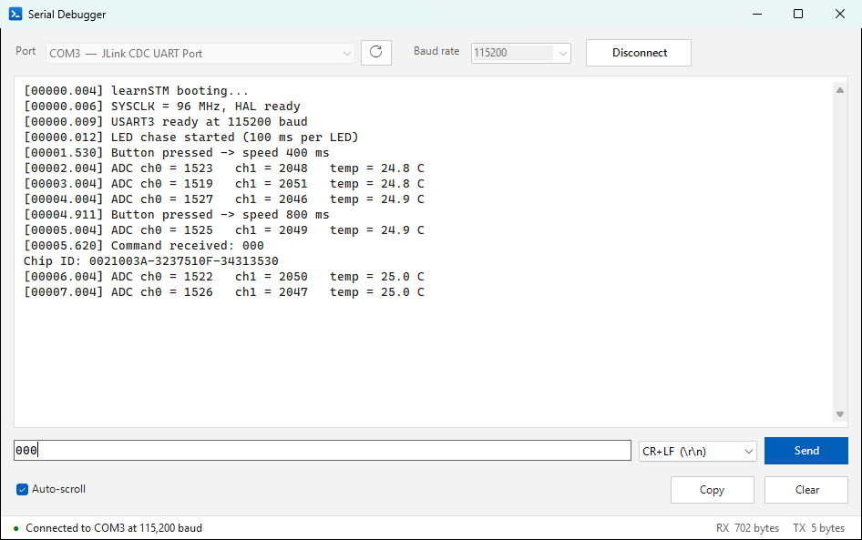

# Serial Debugger

A simple, reliable serial port monitor for Windows 10/11. Pick a port, connect, read the output, send a command. Nothing else to learn.

I made it because I don't like using Tera Term and similar programs for everyday serial debugging of my microcontroller boards.



## Features

- COM ports are listed with their device names (e.g. `COM3 — JLink CDC UART Port`) and the list updates by itself when you plug a board in or out.
- Live output. Select any part of it and copy with **Ctrl+C**, the right-click menu, or the **Copy** button (copies everything if nothing is selected).
- Type in the box under the output and press **Enter** (or **Send**) to send it to the device. The drop-down picks the line ending added after your text (CR+LF by default), and **Up / Down** bring back earlier messages.
- **Auto-scroll** on: always shows the newest output. Off: stays where you scrolled to while data keeps arriving.
- **Clear** (or **Ctrl+L**) empties the output. **F5** refreshes the port list.
- Unplug the board and it waits, then reconnects automatically when it's plugged back in.
- The status bar shows the connection state and the bytes received (RX) and sent (TX).
- Remembers your port, baud rate, auto-scroll, line ending and window size.
- Light, clean Windows 11 style UI.

## Install

Download **SerialDebugger-Setup.exe** from the [latest release](https://github.com/Viskiqt/SerialDebugger/releases/latest) and run it.
It installs for your Windows account only (no administrator rights needed), adds a Start menu shortcut,
and can be removed from **Settings → Apps**. Running a newer setup updates it and keeps your settings.

The installer isn't code-signed, so Windows SmartScreen may warn you the first time. Click **More info → Run anyway**.

## Build

```powershell
powershell -ExecutionPolicy Bypass -File build.ps1
```

This builds the app and the installer and writes `dist\SerialDebugger-Setup.exe`.
You can also open `SerialDebugger.sln` in Visual Studio.

Requirements: .NET SDK (any recent version) and the .NET Framework 4.8 targeting pack
(installed with Visual Studio). No NuGet packages are used.

## How it's built

| Folder | What |
|---|---|
| `src/SerialDebugger` | The app (WinForms, .NET Framework 4.8, which is built into every Windows 10/11 PC, so nothing extra to install) |
| `src/Installer` | The setup program. The app is embedded inside it, and the installed copy doubles as the uninstaller. |
| `tools/New-AppIcon.ps1` | Redraws `App.ico` |

Reliability notes:
- The port is read and written on background threads with the Win32 serial API, so the window never waits on the device,
  and an unplugged device is reported instead of crashing the app.
- Incoming text is shown in batches every 40 ms and the output keeps the newest ~1 million characters,
  so the window stays responsive even at very high data rates.
- Any line ending (`\r\n`, `\n`, `\r`) works; ANSI colour codes and invisible control bytes are removed.

## License

[MIT](LICENSE): free to use, change and share.

## About

This project was generated using AI.
